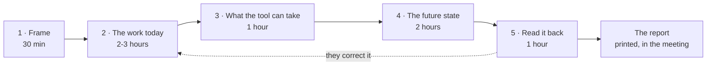
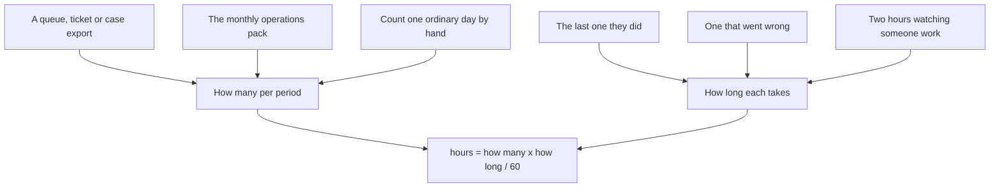

# The method

How to run one case, in a room, with the people whose work it is.

This is the facilitator's guide. [`../TUTO.md`](../TUTO.md) covers the tool;
this covers the engagement — what to ask, in what order, and what to do when the
answers are uncomfortable. [`MEMORANDUM.md`](MEMORANDUM.md) explains why any of
it matters.

Roughly eight to ten hours of your time, spread over two weeks. Most of it is
listening.

That arrow back from session 5 is not a formality. In a first case it fires
about half the time, and a case that never gets corrected by the people in it
usually means they were not asked properly.

---

## The rule that makes it work

**Describe today completely before designing tomorrow.**

Every failure of this method comes from breaking that rule. A room that starts
with the future state produces a description of the vendor's demonstration, and
then reverse-engineers the current process to make the demonstration look good.
You will not get that time back.

So the first session designs nothing. It only asks what happens now, who does
it, how many, and how long.

## Before the room

**Choose one workflow, not a department.** "Personal auto claims intake" works.
"The claims organization" does not. If you cannot name the event that starts the
work and the point where it is finished, the case is too big.

**Get these five people, or reschedule.**

| Who | Why they are there |
|---|---|
| Someone who does the work today | The only person who knows the invisible half of it |
| The operational lead | Volumes, exceptions, what happens when it breaks |
| Whoever is buying the technology | So the claims get made in front of the people affected |
| Someone from risk, legal, or governance | Where the consequences land |
| A worker representative, where one exists | The redistribution of work is theirs to contest |

A session without the first person is not a case. It is an opinion with hours
attached.

**But not all of them in every session.** Invite the sponsor to sessions 1, 3
and 5. Keep them out of session 2. People do not describe the workaround they
invented, or the step they skip when the queue is long, in front of the person
who signs off the process. You will get a procedure read aloud instead of a
workflow, and you will not know the difference until it is too late to fix.

If the sponsor insists on attending, run session 2 twice — once with them, once
without. Where the two differ is your most useful finding, and you can present
it without naming anyone.

**Ask the sponsor one question before you agree to anything:** *has this already
been decided?* Record the honest answer. If it is yes, the report says so on its
first page and you cannot turn that off. Say this out loud at the start, because
finding out later feels like a trap.

**When to walk away.** The refusal criteria are in [`MEMORANDUM.md`](MEMORANDUM.md)
§20 and they are not decorative. The two you will actually meet: a client who
wants the analysis to rank individuals, and a client who wants a
"human-centered" label on a decision that closed months ago. Both cost you the
engagement. Both cost you more if you take them.

---

## Session 1 — Frame the case (30 minutes)

The boundary, the technology, whose budget it is, and the period you will count
in. Pick per week or per month by whichever their volumes already come in.

Then: *what other options were looked at?* Leave it empty if none were. An empty
list beside a decision that is still open is itself a finding, and it appears in
the report as one.

## Session 2 — The work as it runs today (two to three hours)

The long one, and the one that carries everything. Go step by step, in order,
and for each one ask five things: what happens, who does it, how many per
period, how long each takes, and what kind of work it is.

**When they do not know the numbers.** They usually do not. Take the estimate,
record how they know it, and move on. An honest estimate beats a missing
analysis, and the report says how much of the total rests on estimation. Do not
stop the session to go and find a system report — you will lose the room. How to
get better numbers without stopping is the next section.

Two questions to ask on every step, because they are where automation plans die:

- *Is this a decision with consequences, or work being performed?*
- *Does this appear in any procedure?* Work people really do that is written
  down nowhere is the most reliable source of failure after a change.

**Ask this once, near the end, and wait:** *what do you do that nobody upstairs
knows you do?* The silence before the answer is usually the most valuable thing
in the session.

## Session 3 — What the technology can actually take (one hour)

Per step, and never as a group: can it do this today, in your environment, at
what share of the volume, and what happens when it is wrong?

You are recording claims and confidence. **You are not advising anyone what to
automate.** The moment you start recommending, you become the vendor, and every
number afterwards is read as a sales document.

If a vendor is in the room, ask them for the share and record it as `reported`.
If the operations lead disagrees, record `disputed`. Both belong in the file.

## Session 4 — Design the future state (two hours)

For each step, an allocation and the share of volume a person still touches.
That share is the number the whole analysis rests on, so ask for what they
actually believe rather than what the demonstration showed.

**Then the part everyone forgets, and the reason this method exists.**

> What work does this create that nobody does today?

Reviewing what the machine produced. Handling what it escalates. Explaining a
decision the machine made to a customer who is angry about it. In both reference
cases this is a third to a half of the hours that remain. A plan that leaves it
out shows a saving that will not appear.

Ask it as a volume and a duration, like any other work, and give it to a named
role. Work created by a change and assigned to nobody is how a team discovers a
new job by being buried in it.

**The review that cannot happen.** When someone says a human will check every
one, multiply it out in front of them. Four hundred recommendations a day at
three minutes each is twenty hours of reviewing in an eight-hour day. That is
not oversight, and it is better discovered in a meeting room than in a
regulator's letter.

## Session 5 — Read it back (one hour)

Everything here is computed. Nothing new is entered. Bring it back to the people
from session 2 and ask two questions the analysis cannot answer for them:

- *Is this what your job actually looks like?*
- *Does anyone disagree with any of it?*

Record disagreement rather than resolving it quietly. A case that names a
dispute is more useful than one that hides it, and the person who disagreed will
tell others whether you wrote it down.

---

## Collecting the numbers

Everything rests on two figures per step: how many, and how long. This is the
craft part of the work, and it is where an analysis is quietly won or lost.

### How many

In order of preference: a system export, the monthly operations pack, counting
one ordinary day by hand. Counting a day yourself is not a failure — it takes
an afternoon and it is the only figure nobody argues with later.

**Do not take a volume from a manager's memory.** What comes back is the demand
they wish they had, or the demand from the month that hurt. Both are wrong in a
direction that matters.

If the work is seasonal, take an ordinary week and write down that it is an
ordinary week. A peak-week analysis presented without that sentence will be used
against you.

### How long

Asking "how long does this take?" in a group gets you the ideal time, from the
fastest person, on a good day. Ask these three instead:

1. *Think of the last one you did. Walk me through it.* Time the story, not the
   answer.
2. *Now one that went badly. How long did that take?*
3. *Out of ten, how many go like the second one?*

You now have a typical duration, a bad duration, and the mix. That is also a low
and a high — which is exactly what the range fields want, and it came from two
stories instead of a guess. Ranges built this way survive being challenged,
because their owner can describe both ends.

**Two hours of watching beats four hours of asking.** Sit beside one person and
say nothing. You will see the second screen they check, the colleague they walk
over to, and the note they keep in a spreadsheet nobody knows about. None of it
gets reported in an interview, because to them it is not work — it is just what
you do.

### Two techniques that change what you get

**Walk the workflow backwards.** Start from the finished output and ask what had
to happen immediately before it. Forward walkthroughs follow the procedure;
backward walkthroughs follow what actually happened.

**Describe the exception path as its own steps.** Ask what share of cases do not
go the normal way. In most administrative work the fifth of cases that goes
wrong takes more than half the hours, and a plan built on the normal path
automates the cheap part.

### Rework, and how to count it

Work that comes back is its own step with its own volume, not a share of the
main one. Chasing documents that happens for 210 of 700 claims is a step of 210,
not 700 — and the volumes across a workflow are independent for exactly this
reason.

Get this wrong in either direction and the answer moves more than most people
expect. Ask it plainly: *what comes back to you, and how often?*

### Practical

**Bring** a printed step sheet, a watch, and nothing else. A laptop screen
between you and someone describing their job changes what they say.

**Capture per step, in this order** — everything after the fifth column can wait
for a quiet afternoon:

| What happens | Who | How many | How long | Kind of work | Comes back? | In any procedure? |
|---|---|---|---|---|---|---|

**When you run out of time, cover the biggest steps and stop.** Ten steps
holding four fifths of the hours beat thirty steps holding all of them. The
report is read by people who will look at four rows.

## Saying "I don't know" properly

Four numbers decide the answer: the share still passing through a person, how
long the human part takes, and the volume and duration of the work the change
creates. When someone genuinely does not know one, do not push them to a single
figure. Ask instead:

> What is the lowest you would defend, and the highest?

Enter both. The report then shows a band rather than one confident number, and
names which single estimate decides most of its width.

Three things follow, and they are the most useful part of the whole session:

- **A band that reaches "no change at all" ends an argument.** It means their own
  numbers do not establish that the workflow shrinks. That is worth knowing
  before the steering committee, not after.
- **The widest parameter is what to measure.** Not everything — that one. It
  turns "we should run a pilot" into "run four hundred real items through it and
  count what it escalates", which is a week of work with a defined answer.
- **If the conclusion holds across the whole band, say so and stop.** Measuring
  would change nothing, and telling a client not to spend money is the cheapest
  trust you will ever buy.

## What goes wrong

The first three are failures. The fourth is not, and mistaking it for one is its
own mistake.

**The vendor's process, not theirs.** Symptom: the steps match a product
brochure. Cause: session 4 happened before session 2, or the vendor was in
session 2. There is no repair — run session 2 again with different people.

**The saving that reappears.** Symptom: a large percentage and a nervous
operations lead. Cause: created work was never entered. Go back and ask who
reviews the output and who takes the escalations.

**The exception averaged away.** Symptom: every step has a suspiciously round
duration and the workflow looks simple. Cause: one duration was taken for a step
that really has two — the normal case and the one that goes wrong. Split it.

**The role that grows.** Symptom: a workflow shrinks by half while one role gets
busier. This is *not* an error. It is the most common real finding in this
method, it is almost never in the business case, and it usually lands on the
most senior and scarcest person in the process. Check it, then lead with it.

Four more that cost time rather than accuracy:

- **"Let us clean the data first."** The analysis does not restart. Take the
  estimates, mark how sure they are, and let the report show what rests on them.
- **The vendor's addressable share taken as fact.** Record it as reported, and
  record the operations lead's number beside it as disputed. Both belong in the
  file; neither is yours to arbitrate.
- **Filling the silence.** After you ask what nobody upstairs knows they do,
  count to ten. The answer arrives at about eight.
- **Interviewing only the fast people.** Managers volunteer their best performer.
  Ask for someone who joined in the last year as well; the difference between
  them is the training requirement nobody has written down.

## Reading the output with a steering committee

**Never show a percentage without its hours.** A kind of work can grow from 15%
to 26% of a role while the role loses a third of its hours. Showing either
number alone misleads, so the tool always returns both — keep them together on
the slide too.

**Lead with what grows, not what shrinks.** The work that grows is the
capability requirement, and the capability requirement is the transition. A room
that starts on what shrinks spends the hour on headcount and never reaches it.

**The tool does not tell anyone what their headcount should be.** It tells them
the size of the question. If someone asks it for the answer, that is the moment
to repeat the sentence rather than soften it.

**One number travels, and it should be a count.** *Six decisions have no owner*
survives being repeated in a corridor. A score does not, because the first thing
anyone does with a score is argue about the weighting.

## What you hand over, and what you never do

**Hand over:** the case file itself, the printed report, and one page of your own
words saying what you would do next. The file matters more than it looks — the
client can reopen it in a year, change three numbers, and see what the change
actually did. That is what makes this different from a slide deck, and it is
worth saying out loud when you deliver it.

**Never hand over:** a headcount recommendation, a list of people, or anything
per-person. If a client asks who should go, the honest answer is that this
analysis measures work, not people, and cannot answer that question — which is
true, and is also the reason they can trust the rest of it.

**Say what you did not cover.** Steps you skipped for time, numbers that came
from one person, a share you took from a vendor. The report already reports
unassessed hours on their own; your covering page should match its honesty.

## What this method does not do

It does not decide whether the change is wise. It does not rank people, and it
never needs an employee's name. It does not certify anything: a complete case
file means the information is present and consistent, not that the transition is
responsible, safe, or likely to work.

And it produces no grade. There is no maturity level to climb and no badge to
put on a slide, deliberately — a score invites gaming, and the counts point at
specific work instead.

---

*This method is licensed [CC BY 4.0](LICENSE). Use it, teach it, put it in your
own tool — attribution is the only condition. If you improve it, the reference
cases in [`../examples/`](../examples) are where it shows.*
